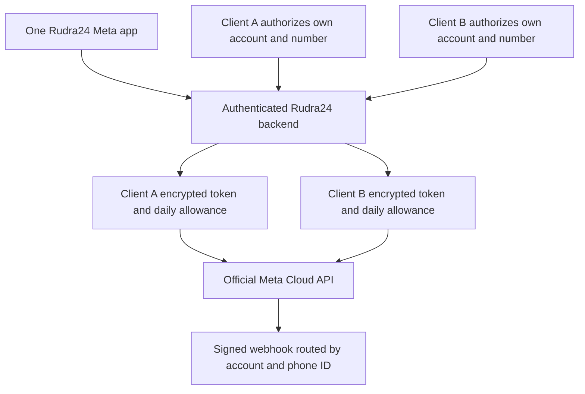

# Rudra24: direct Meta WhatsApp setup

Checked against Meta's developer documentation on 8 October 2026. This guide uses Meta Cloud API directly; no third-party BSP subscription is required. Dashboard labels can change.

## The account structure

Use **one Rudra24 Meta app**, connected to your verified business portfolio, as a **Tech Provider**. Each client authorizes their own WhatsApp business assets through Embedded Signup. Store the resulting business integration system user token encrypted against that client's authenticated account. The client owns their business account and phone number; Rudra24 operates the authorized integration.

You do not buy a separate API key for each client. App ID and App Secret belong to the platform; customer access tokens are generated by authorization and may expire or be revoked. Treat “one parent API” as one app/integration, not one unrestricted token copied into every customer's app. Do not put App Secret or business tokens in the EXE, frontend config or localStorage.



## 1. Create your platform account and Meta app

1. Open [Meta Business Suite](https://business.facebook.com/) and create/select the Rudra24 business portfolio. Enter the real business name, address, phone, website and contact information.
2. Open [Meta for Developers](https://developers.facebook.com/apps/), create an app with the **WhatsApp** use case, and associate the Rudra24 business portfolio.
3. In App Dashboard, open **Use cases → Customize → WhatsApp → Tech Provider onboarding**. Choose **Onboard without a partner** if the dashboard offers the partner variation. Meta explicitly supports providing messaging independently as a Tech Provider.
4. Complete business verification. Provide the documents and contact verification requested by Meta. This is the platform business verification; customer asset requirements remain separate.
5. Fill the app's Basic settings: icon, category, website/domain, privacy policy, terms and data-deletion instructions. Use your actual hosted app and backend URLs.

Official guide: [Become a Tech Provider](https://developers.facebook.com/documentation/business-messaging/whatsapp/solution-providers/get-started-for-tech-providers).

## 2. Test with your own business first

1. In the WhatsApp use case's API Setup, use Meta's test number and temporary token.
2. Add and verify your own WhatsApp recipient number as a test recipient.
3. Send Meta's supplied test template and confirm it appears on the recipient's phone. Test credentials are for this development step; do not distribute them to clients.
4. Create a real template in WhatsApp Manager and submit it for approval. A company introduction, offer or sales pitch belongs in the **Marketing** category; do not label promotional content Utility to avoid charges.
5. Capture the evidence required for App Review. Meta asks for a message sent and received, and template creation. The official onboarding guide allows API Setup/cURL and WhatsApp Manager recordings as alternatives to demonstrating those actions in the app.

Your app can load approved templates and send numbered text-body templates. Static text headers are supported; media/dynamic headers, named parameters and advanced interactive template components are not supported by this composer. Brochure sending uses the separate pitch-document workflow and the same client sender/quota checks.

## 3. Get permission to onboard other businesses

Request **Advanced Access** through App Review for:

- `whatsapp_business_management`: customer business accounts, numbers and templates.
- `whatsapp_business_messaging`: sending on behalf of the customer.

Complete the review requirements shown for your app, including any access verification, test login instructions and screencasts. Put the app in **Live** mode after required approvals. Development-mode access to your own/test assets does not prove that external customers can onboard. No local code change can grant Meta approval.

## 4. Configure Embedded Signup v4

1. Open **Facebook Login for Business → Configurations**.
2. Create a new configuration with the **WhatsApp Embedded Signup** login variation.
3. Select **WhatsApp Cloud API**. Select additional products only if you intend to implement them. v4 determines its required assets and permissions from the selected products.
4. Use the appropriate system-user/business-token configuration shown by the dashboard. Record the Configuration ID; token expiration and revocation still require reconnect handling.
5. In **Facebook Login for Business → Settings**, configure the required OAuth and JavaScript SDK toggles. Add the exact HTTPS app domain and valid redirect URLs to the allowed lists.
6. Run client onboarding from the hosted HTTPS web app. A local `file://` EXE view cannot serve as Meta's approved HTTPS onboarding domain.

**Current deadline:** Meta says Embedded Signup v2 and v3, including their previews, retire on **15 October 2026**. This integration uses v4 configuration rather than starting a new legacy flow.

Official references: [v4](https://developers.facebook.com/documentation/business-messaging/whatsapp/embedded-signup/version-4), [implementation](https://developers.facebook.com/documentation/business-messaging/whatsapp/embedded-signup/implementation).

## 5. Configure the existing backend once

Set these on the privately hosted FastAPI backend, never in frontend files:

```dotenv
META_APP_ID=your-platform-app-id
META_APP_SECRET=your-platform-app-secret
META_GRAPH_VERSION=v26.0
WHATSAPP_API_VERSION=v26.0
WHATSAPP_EMBEDDED_CONFIG_ID=your-v4-configuration-id
WHATSAPP_WEBHOOK_VERIFY_TOKEN=your-long-random-verification-value
CREDENTIAL_MASTER_KEY=your-existing-stable-encryption-master-key
CLAVIS_ADMIN_EMAILS=your-verified-operator-email
```

Use the backend's existing Supabase authentication, database and CORS/host configuration. Preserve the existing encryption master key: changing it without re-encryption makes stored credentials unreadable. Run the included database migration on deployments that disable automatic schema creation. Restart the backend after configuration changes.

For selling the app, use **one centrally hosted backend** that all authenticated clients call. A backend installed on each client's computer would hand them control over the daily quota and could expose platform credentials. Configure the existing frontend `BACKEND_URL` to the actual HTTPS backend or use the existing same-origin API proxy.

## 6. Connect the shared webhook

In the Meta app's WhatsApp/Webhooks configuration:

1. Set callback URL to `https://YOUR_BACKEND/api/v1/whatsapp/webhook`.
2. Enter the same `WHATSAPP_WEBHOOK_VERIFY_TOKEN` and complete verification.
3. Subscribe to **messages** for sent/delivered/read/failed receipts and **account_update** for onboarding/account lifecycle events. Template status/quality and phone quality fields are useful additions when building monitoring.
4. Each connected client account must be subscribed to the app through `/{WABA_ID}/subscribed_apps`; onboarding performs this server-side.
5. For WhatsApp Business App coexistence also enable **history**, **smb_app_state_sync** and **smb_message_echoes** before onboarding.

Webhook verification token is a setup secret. Actual POST notifications are verified separately using `X-Hub-Signature-256` and the App Secret. A successful send API response is **accepted**, not proof of delivery.

## 7. Connect each client and choose their number

1. Create the client's own Rudra24 login/workspace. Sign in as that client or have them perform onboarding; do not connect every company under your operator login.
2. Open **WhatsApp → Official Meta Cloud API → Connect with Meta**. The client authorizes their business assets in Meta's own flow.
3. Select/create the client's business account and connect the intended number. Verify ownership using the SMS/voice verification Meta requests.
4. For a new Cloud API number, provide the requested six-digit two-step verification PIN during setup; the backend must complete phone registration. Already registered pure Cloud API numbers can be linked with authorized credentials.
5. The backend exchanges Meta's short-lived code for that client's business token, verifies its app/scopes and account/number membership, subscribes the account, and stores the encrypted binding. The IDs returned by the browser are hints, not authorization.
6. For assisted first-client setup, use **Authorized credentials** with a token generated for this same platform app and authorized business assets, the business account ID and phone number ID. The token is sent to the backend and cleared from the form.
7. Add the appropriate payment method to the client's Meta messaging account. Tech Provider onboarding is not the same as obtaining a Solution Partner credit line. A single app does not automatically consolidate all customer bills onto your platform.

**Existing numbers:** prefer the official **WhatsApp Business App coexistence** flow when Meta says the number is eligible. This can preserve Business App use alongside Cloud API, but has device/feature limitations and requires history/state synchronization. Ordinary consumer WhatsApp registration and WhatsApp Business App registration are different cases. Do not delete an existing WhatsApp account to “try it”; use the official migration/coexistence steps and obtain the client's informed agreement for a migration.

Coexistence requires initiating contacts/history synchronization within 24 hours of onboarding, and skipping normal Cloud phone registration because the number is already registered. Do not interpret “token saved” as completed coexistence synchronization or a full imported inbox. The app surfaces the supported setup state; check its verification notes for the current synchronization limits.

References: [Tech Provider customer onboarding](https://developers.facebook.com/documentation/business-messaging/whatsapp/embedded-signup/onboarding-customers-as-a-tech-provider), [existing Business App numbers](https://developers.facebook.com/documentation/business-messaging/whatsapp/embedded-signup/onboarding-business-app-users).

## 8. Set your client plans

Open the existing **Operator console** (`Ctrl+Shift+O`, with an email allowed by `CLAVIS_ADMIN_EMAILS`). Choose each client's WhatsApp allowance and save:

| Your app plan | Daily allowance | Maximum over 30 fully used days |
| --- | ---: | ---: |
| Basic | 20 | 600 |
| Mid | 50 | 1,500 |
| Pro | 100 | 3,000 |
| Custom Basic | 25 or 30 | 750 or 900 |

Daily quotas are enforced server-side per authenticated client, reset at midnight **Asia/Kolkata**, and do not roll over. These are Rudra24 caps, not Meta messaging limits. Requests reserve quota before sending; an uncertain send retains its reservation to prevent duplicate sends and spend. Meta billing counts actual delivered messages, so the two counters can differ.

The existing calling-payment plans are not renamed or automatically mapped to these WhatsApp presets. WhatsApp allowances are assigned by the operator; customers cannot self-upgrade by changing a browser setting.

## 9. Personalize and test one real message

1. In the client's WhatsApp Manager create a Marketing template, for example: `Namaste {{1}}, {{2}} se {{3}}. Kya aap hamari services ki details chahenge? Reply STOP to opt out.` Supply genuine example values and wait for approval. Meta decides category and eligibility.
2. In Rudra24 refresh approved templates, select the matching template/language and an opted-in recipient.
3. Fill numbered values with actual company/contact details, or use the app's `{Company}`, `{City}` and `{Name}` substitutions. Use the client's own business name in the appropriate value; do not accidentally use Rudra24 branding for every company.
4. Review the personalized preview and confirm that this specific recipient has agreed to WhatsApp messages from this company.
5. Send once. Check **accepted → sent → delivered/read** using signed receipts; “read” is only available where Meta returns it.
6. Test a second client to confirm that the number, templates, history and allowance are separate. Test revoked credentials, an unapproved template and an exhausted allowance.
7. If a network timeout leaves the result unknown, refresh history and investigate before attempting another send. Do not assume a timeout means Meta did not receive it.

A scraped/public telephone number is not opt-in. Respect opt-out requests and Meta's quality/per-user marketing restrictions. Low daily volume does not exempt a business from those requirements.

## Costs and operational limits

Direct Meta access avoids a BSP subscription/markup, but does not make messaging free. API access tokens are not products you buy per customer. Meta bills by delivered message category and destination market; SIM/number acquisition, hosting, taxes and your own app subscription are separate.

**Do not use old “all replies within 24 hours are free” advice.** Meta's developer pricing update, revised 28 September 2026, says that from **1 October 2026** service messages and utility templates sent within the customer-service window are also charged per delivered message. The 24-hour rule still determines when non-template replies are allowed. Free-entry-point exceptions have separate conditions. Check the current account rate card before quoting INR rates or promising bundled free messages.

References: [official pricing updates](https://developers.facebook.com/documentation/business-messaging/whatsapp/pricing/non-template-messages), [current rate cards](https://developers.facebook.com/documentation/business-messaging/whatsapp/pricing).

What still requires your Meta account: business verification, App Review, a live app/configuration, public HTTPS webhook, registered/eligible numbers, approved templates, payment method and a real send/receipt test. These cannot be completed by adding code alone.
